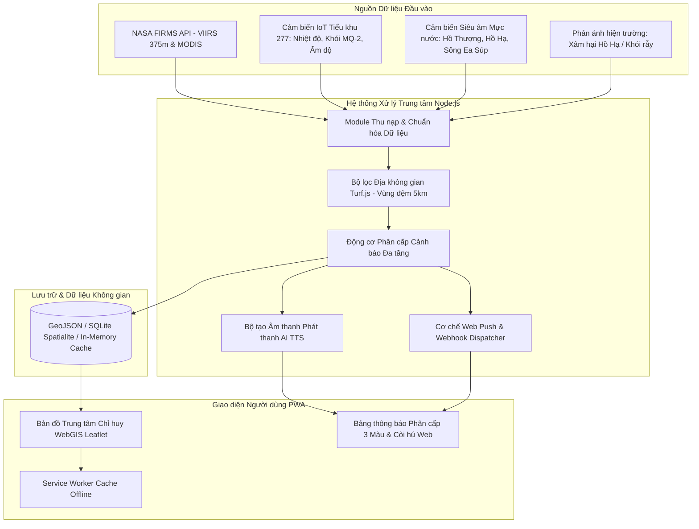

# BẢN ĐẶC TẢ THIẾT KẾ KỸ THUẬT (SYSTEM SPECIFICATION)
## DỰ ÁN: HỆ THỐNG CẢNH BÁO SỚM CHÁY RỪNG VÀ GIÁM SÁT THỦY VĂN LŨ HẠN XÃ EA SÚP
- **Tên miền mục tiêu**: `https://canhbao.easupso.com`
- **Đơn vị chủ quản**: Ban Chỉ huy Phòng chống thiên tai & Tìm kiếm cứu nạn (PCTT & TKCN) xã Ea Súp, tỉnh Đắk Lắk.
- **Ngày lập đặc tả**: 02/11/2026.
- **Trạng thái**: Đã phê duyệt qua quy trình Brainstorming Socratic.

---

## 1. BỐI CẢNH ĐỊA BÀN VÀ PHẠM VI QUẢN LÝ

### 1.1. Phạm vi Địa lý Cụ thể
1. **20 Thôn, Buôn trực thuộc xã Ea Súp**:
   - Khối Thôn số: Thôn 1, Thôn 2, Thôn 3, Thôn 4, Thôn 5, Thôn 6, Thôn 7, Thôn 8, Thôn 9, Thôn 10, Thôn 11, Thôn 12, Thôn 13.
   - Khối Thôn tên chữ: Thôn Thắng Lợi, Thôn Đoàn Kết, Thôn Hòa Bình, Thôn Bình Lợi.
   - Khối Buôn đồng bào: Buôn A, Buôn B, Buôn C.
2. **Khu vực Trọng điểm Cháy rừng**:
   - **Tiểu khu 277**: Vùng rừng khộp đặc trưng, tích lũy thảm mục thực bì dày vào mùa khô, giáp ranh vùng đệm canh tác nông nghiệp.
3. **Thủy hệ & Hồ chứa Trọng điểm**:
   - **Hồ Ea Súp Thượng**: Công trình hồ chứa đại thủy nông lớn nhất tỉnh Đắk Lắk (dung tích thiết kế ~146 triệu m³), đập dâng, tràn xả lũ tự do và cống lấy nước điều tiết.
   - **Hồ Ea Súp Hạ**: Hồ chứa điều tiết nước sinh hoạt cho nhân dân thị trấn Ea Súp và các xã lân cận. **BẤT BIẾN NGHIỆP VỤ: TUYỆT ĐỐI CẤM MỌI HÀNH VI NUÔI CÁ LỒNG BÈ / THỦY SẢN ĐỂ BẢO VỆ NGUỒN NƯỚC SINH HOẠT.**
   - **Khu vực Hồ cá Thôn Đoàn Kết**: Vùng hạ du trũng thấp, chuyên canh tác ao nuôi thủy sản nước ngọt của người dân, có nguy cơ ngập lụt vỡ bờ khi hồ xả lũ hoặc sông dâng cao.
   - **Sông Ea Súp**: Trục tiêu thoát lũ chính đi qua các thôn trũng, tiếp nhận lưu lượng xả từ Hồ Thượng.
4. **Vùng đệm Liên xã (Bán kính 5km)**:
   - Xã Ea Bung, Xã Ea Rốk, Xã Ia Lốp, Xã Ia Rvê. Khi phát hiện cháy rừng hoặc ngập lụt vùng biên, hệ thống tự động gán cờ phối hợp liên vùng.

---

## 2. KIẾN TRÚC HỆ THỐNG VÀ CÁC THÀNH PHẦN

---

## 3. LOGIC NGHIỆP VỤ & CÁC NGƯỠNG CẢNH BÁO CHI TIẾT

### 3.1. Phân hệ Cảnh báo Sớm Cháy Rừng (NASA FIRMS & IoT Tiểu khu 277)
Áp dụng cơ chế **Lọc đa tầng (Multi-tier Filtering)**:
1. **Nguồn NASA FIRMS (VIIRS SNPP/NOAA-20/NOAA-21, MODIS)**:
   - Tọa độ Bounding Box quét: Xã Ea Súp mở rộng bán kính 5km (Ea Bung, Ea Rốk, Ia Lốp, Ia Rvê).
   - Điểm nóng được ghi nhận khi:
     - `confidence` in `['nominal', 'high']` (hoặc `confidence >= 50%` đối với MODIS).
     - Bức xạ nhiệt `FRP >= 5.0 MW` (Fire Radiative Power).
2. **Nguồn Trạm IoT Tiểu khu 277**:
   - Tần suất gửi telemetry: 30 - 60 giây/lần.
   - Ngưỡng nhiệt độ báo động: `temperature > 55.0°C`.
   - Ngưỡng khói khí gas: `smoke_mq2_raw > 450` hoặc `ppm > 80`.
3. **Ma trận Phân cấp Cháy Rừng**:
   - **MỨC VÀNG (Cảnh báo Tiềm ẩn)**: Điểm nhiệt FIRMS ngoại vi vùng đệm 5km HOẶC chỉ số hạn khô FWI cao (Nhiệt độ môi trường > 38°C, độ ẩm không khí < 35%).
   - **MỨC CAM (Nguy cơ Cao)**: Có điểm nhiệt FIRMS trong phạm vi Tiểu khu 277 / 20 thôn buôn nhưng chưa có cảm biến IoT xác thực.
   - **MỨC ĐỎ (Báo động Đỏ Khẩn cấp)**: Điểm FIRMS đồng vị trí cảm biến IoT Tiểu khu 277 ĐANG BÁO CHÁY, HOẶC cảm biến IoT kích hoạt liên tục trong 3 chu kỳ đo.

### 3.2. Phân hệ Giám sát Thủy văn, Lũ lụt & Khô hạn
Áp dụng **3 Cấp Thủy văn chuẩn hóa**:
1. **Hồ Ea Súp Thượng (Đại thủy nông)**:
   - Dung tích thiết kế: 146 triệu m³. Cao trình đỉnh đập: 215.5m. Cao trình dâng bình thường (MNDBT): 210.0m. Cao trình mực nước chết (MNC): 198.0m.
   - **Cấp 1 (Cảnh báo sớm - Vàng)**: Mực nước đạt > 80% dung tích (cao trình >= 208.5m) hoặc xuống thấp < 25% (nguy cơ cạn kiệt tưới tiêu mùa khô).
   - **Cấp 2 (Báo động - Cam)**: Mực nước đạt > 92% dung tích (cao trình >= 209.5m), dòng chảy thượng nguồn đổ về lớn (> 150 m³/s).
   - **Cấp 3 (Khẩn cấp - Đỏ)**: Mực nước vượt tràn xả lũ tự do (> 210.0m), nguy cơ xả lũ khẩn cấp đe dọa vùng hạ du Thôn 1 - Thôn 13 và hồ cá Thôn Đoàn Kết.
2. **Hồ Ea Súp Hạ (Cấp nước Sinh hoạt - Cấm Nuôi Cá)**:
   - **Bất biến giám sát**: Bất kỳ tín hiệu báo có lồng bè hoặc chỉ số ô nhiễm hữu cơ (TDS, DO, turbidity tăng bất thường) -> Phát cờ `VIOLATION_AQUACULTURE_DETECTED` màu đỏ cảnh báo vi phạm lệnh cấm bảo vệ nguồn nước.
   - **Ngưỡng hạn kiệt**: Mực nước sụt dưới ngưỡng 30% dung tích an toàn sinh hoạt -> Cảnh báo thiếu nước sinh hoạt toàn địa bàn.
3. **Khu vực Hồ cá Thôn Đoàn Kết & Hạ lưu Sông Ea Súp**:
   - Khi Hồ Thượng xả lũ > 100 m³/s HOẶC mực nước sông Ea Súp vượt báo động ngập bờ (> 2.5m so với đáy sông): Kích hoạt ngay kịch bản di dời tài sản, bảo vệ chống tràn bờ ao nuôi thủy sản Thôn Đoàn Kết.

### 3.3. Phân hệ Phát thanh Thông minh AI TTS & Đa kênh
- **Công nghệ TTS**: Web Speech API kết hợp Audio Synthesis Engine tiếng Việt, tự động tổng hợp câu thông báo cứu nạn theo mẫu văn bản:
  - *“Thông báo khẩn cấp từ Ban Chỉ huy Phòng chống thiên tai xã Ea Súp: Hiện tại phát hiện điểm cháy rừng/xả lũ tại khu vực [Địa điểm], mức độ [Cấp độ]. Đề nghị nhân dân Thôn [Tên thôn/buôn] nâng cao cảnh giác, sẵn sàng phương án ứng phó.”*
  - Hỗ trợ tóm tắt ngắn cho đồng bào Buôn A, Buôn B, Buôn C.
- **Kênh phân phối**:
  - Giao diện Web Command Center: Còi hú âm thanh báo động (Web Audio API Synthesizer đa tần số).
  - PWA Web Push Notifications: Đẩy alert tới điện thoại của 20 Trưởng thôn và Đội PCCC cơ động.
  - Webhook Dispatcher: Sẵn sàng kết nối SMS Gateway / Zalo OA.

---

## 4. THIẾT KẾ DỮ LIỆU & GIAO DIỆN API

### 4.1. Lược đồ Đối tượng Dữ liệu (Schemas)
- `FeatureCollection GeoJSON` biểu diễn 20 thôn buôn với mã định danh `commune_id: "EASUP"`, `unit_type: "THON" | "BUON"`.
- `SensorStation`: `{ id, name, location: [lat, lng], type: "FIRE" | "HYDRO", water_level, flow_rate, temp, smoke, battery, status }`.
- `FireHotspot`: `{ id, lat, lon, brightness, scan_time, satellite, confidence, frp, buffer_flag }`.
- `AlertEvent`: `{ id, timestamp, level: "YELLOW" | "ORANGE" | "RED", domain: "FIRE" | "HYDRO" | "ENVIRONMENT", location, description, tts_text, acknowledged }`.

### 4.2. Danh sách Endpoints RESTful
- `GET /api/v1/geo/boundaries`: Lấy ranh giới 20 thôn buôn, Tiểu khu 277, Hồ Thượng, Hồ Hạ, Hồ cá Đoàn Kết, Sông Ea Súp.
- `GET /api/v1/firms/hotspots`: Danh sách điểm nhiệt NASA FIRMS đã qua bộ lọc 5km và FRP >= 5MW.
- `GET /api/v1/iot/telemetry`: Dữ liệu đo đạc thời gian thực từ các trạm cảm biến.
- `GET /api/v1/alerts/active`: Danh sách cảnh báo hiện hữu kèm cấp độ 1-2-3.
- `POST /api/v1/alerts/simulate`: API hỗ trợ diễn tập tình huống khẩn cấp cho Ban chỉ huy PCTT xã.
- `POST /api/v1/tts/synthesize`: Trả về dữ liệu âm thanh hoặc kịch bản đọc cho hệ thống truyền thanh IP.

---

## 5. THIẾT KẾ GIAO DIỆN TRỰC QUAN (WEBGIS DASHBOARD)
- **Phong cách Thiết kế**: Rich Aesthetics - Dark Command Center Theme (Sleek slate dark background `#0b1120`, Glassmorphism panels, Dynamic glow indicators, High-contrast warning badges).
- **Thanh Chỉ huy Trung tâm (Command Top Bar)**:
  - Đồng hồ thời gian thực Đắk Lắk (UTC+7).
  - Trạng thái tổng quan: Đếm số điểm cháy, Số hồ mức báo động, Trạng thái nguồn nước Hồ Hạ.
  - Nút Diễn tập tình huống (Simulation Mode).
- **Khung Bản đồ Tương tác Không gian (Interactive WebGIS Canvas)**:
  - Nền bản đồ vệ tinh / địa hình / vector chuyển đổi linh hoạt.
  - Lớp ranh giới 20 thôn buôn hiển thị nhãn rõ ràng.
  - Đánh dấu đặc biệt: Tiểu khu 277 (vùng cảnh báo lửa), Hồ Ea Súp Hạ (Biểu tượng Giọt nước xanh kèm cờ đỏ Cấm nuôi cá), Hồ Ea Súp Thượng (Trạm đo dung tích hồ), Hồ cá Thôn Đoàn Kết.
  - Heatmap/Point marker hiển thị các điểm nhiệt NASA FIRMS kèm bán kính đệm 5km.
- **Bảng Điều khiển Cảnh báo & Phát thanh (Alert & TTS Dispatch Console)**:
  - Danh sách cảnh báo xếp theo mức độ ưu tiên: Đỏ -> Cam -> Vàng.
  - Bộ phát thanh AI TTS tích hợp: Nút "Nghe thử bản tin", "Phát thanh tới loa thôn/buôn", "Kích hoạt còi báo động".
- **PWA Offline Mode**:
  - Hỗ trợ lưu đệm bản đồ số và danh bạ 20 thôn buôn khi mất kết nối mạng.
